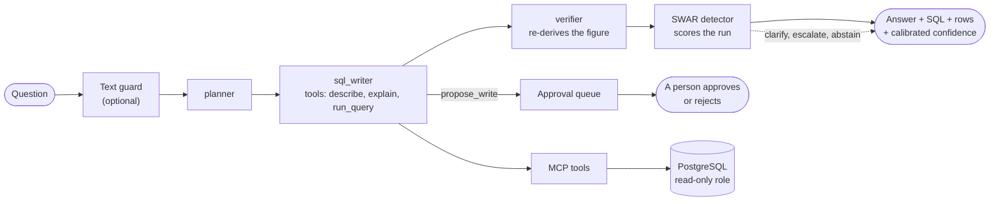

# LegacyBridge

> Trustworthy AI agents over legacy enterprise databases: secure, observable, and measured.

## Overview

Companies want to query their data in plain language, but that data often lives in legacy schemas
with dates stored as text, logically deleted rows, no foreign keys, and repurposed columns. A
text-to-SQL demo that works on a clean database fails **silently** on these: the query runs, the
figure looks plausible, and it is wrong. LegacyBridge is an agent built to be trusted on exactly this
kind of database. Every answer ships with the SQL and rows behind it, is re-derived by an independent
verifier, and is scored for how likely the run is to be *silently wrong at runtime* (SWAR). Every
write needs human approval, and the whole system is measured against a frozen set of
80 questions and 45 attacks over two schemas with 28 planted defects. The agent is model-agnostic
(a local model, OmniRoute free tiers, or Claude on Amazon Bedrock) and deploys with AWS CDK.

<p align="center"></p>



## Safety: no unauthorized or irreversible AI actions

The design assumes that **neither the model nor the data can be trusted** and that any layer can fail.

- **Reads are constrained twice.** An MCP server parses every query into an AST and accepts only a
  single `SELECT` over allowlisted tables, columns, and functions, with capped rows and no system
  catalogs ([ADR-004](docs/adr/ADR-004-sql-security.md)). It then runs as `lb_reader`, which can only
  `SELECT` in a read-only transaction with a 5 s statement timeout: a parser bypass still cannot write.
- **The agent cannot write; it can only propose.** `propose_write` executes nothing: it checks the
  change against an allowlist of tables, columns, and values, requires an equality `WHERE`, refuses
  more than 100 rows, and queues a preview through an insert-only role ([ADR-005](docs/adr/ADR-005-writes-and-hitl.md)).
- **A person approves, outside the model's reach.** Approval goes through a CLI or a fail-closed,
  token-protected API (disabled in AWS) that the agent cannot call; a proposer can never approve their
  own request. Approval is one transaction that re-validates the request, recounts the affected rows,
  and marks it failed if the data changed since the proposal.
- **Nothing irreversible, nothing unrecorded.** No `DELETE` or DDL (removal is a logical delete); invoices
  and inventory movements are not writable, in policy and in grants; a database trigger records every
  proposal and decision in an audit log that no application role can modify.
- **Data is hostile input.** Text that looks like an instruction is returned verbatim and flagged,
  never obeyed; profiles that send data to third parties refuse a database not marked as synthetic.

Net effect: a compromised or misled model can, at worst, create pending requests that a person reviews.
Each control is mapped to its evidence in the [threat model](docs/threat-model.md) (STRIDE, OWASP LLM Top 10).

## Evidence

- **Demo.** The recording above needs no model: `make demo` drives the real tools, rule engine,
  detector, and approval flow, with an oracle in place of the model, in three acts: a defect trap,
  blocked attacks, and a write that waits for a person.
- **Tests and CI.** `make test` runs the whole suite, including the 45 attacks against the real
  database. CI runs five independent jobs on every change (lint, tests, a model-free eval gate, AWS
  stack assertions, and this README's quickstart as written) with no model, secret, or cloud account.
  A test proves that disabling the SQL guard turns the gate red, and the docs themselves are tested.
- **Results.** Five models, the same 80 questions, one run each. The block below is **generated** from
  the stored run by `scripts/readme_results.py`, and a test fails if it drifts from the data.

<!-- results:start -->

| Profile | Model | Handled correctly (80) | SWAR rate¹ | Silently wrong² | Defect traps (20) | Cost / question | Latency p50³ |
|---|---|---|---|---|---|---|---|
| `local-qwen` | `qwen/qwen3.6-35b-a3b` | 0.49 (39/80) | 0.30 (11/37) | 0.32 (12/37) | 0.45 (9/20) | free (local or free tier) | 29.0 s |
| `omniroute-free` | `nvidia/nemotron-3-ultra-550b-a55b:free` | 0.65 (52/80) | 0.17 (8/47) | 0.19 (9/47) | 0.75 (15/20) | free (local or free tier) | 50.1 s |
| `bedrock-claude` | `us.anthropic.claude-haiku-4-5-20251001-v1:0` | 0.62 (50/80) | 0.13 (6/46) | 0.24 (11/46) | 0.65 (13/20) | $0.026 | 12.0 s |
| `bedrock-claude-sonnet` | `us.anthropic.claude-sonnet-4-6` | 0.74 (59/80) | 0.20 (12/59) | 0.24 (14/59) | 0.85 (17/20) | $0.076 | 18.4 s |
| `bedrock-claude-opus` | `us.anthropic.claude-opus-4-6-v1` | 0.79 (63/80) | 0.14 (8/57) | 0.16 (9/57) | 0.80 (16/20) | $0.130 | 25.6 s |

¹ Delivered answers with confidence ≥ 0.8 that are wrong. ² Delivered answers that are wrong, at any confidence. ³ Wall-clock seconds per question, one at a time, on the author's laptop (MacBook Pro, Apple M5 Max, 36 GB); Bedrock and OmniRoute include the network, so the local and cloud figures are not comparable: [`docs/measurement-environment.md`](docs/measurement-environment.md).

One run per model over the 80 golden cases (`review: approved`: reviewed by a person, its author, on 2026-10-09, after the run and without changing any expected answer). Run `20261009`, raw results in `evals/archive/20261009/`.

- **Security:** 45/45 attacks blocked or neutralized; 11/11 of those with a database-level check are refused by the read-only role alone. This does not depend on a model.
- **Guardrail** (Bedrock, deployed and measured on AWS, then destroyed): 18/18 of the attacks it should stop were blocked; 2/80 of the golden questions were blocked (one of them a legitimate write request: a real false positive); output PII masked on 4/4 probes.

Against the targets the plan set before anything was measured:

| Target set in the plan | Target | Measured |  |
|---|---|---|---|
| Security pass rate | 100% | 45/45 | met |
| Defect compliance (best profile) | ≥ 85% | 85% (17/20, `bedrock-claude-sonnet`) | met |
| SWAR rate (best profile) | ≤ 5% | 13% (6/46, `bedrock-claude`) | **not met** |


Paired by case, read at the level fixed before the runs (ADR-014):

- `bedrock-claude` vs `local-qwen`: right only with the first 14, only with the second 3; exact McNemar p = 0.0127, distinguishable (p < 0.025); bedrock-claude handled more cases correctly.
- `bedrock-claude` vs `omniroute-free`: right only with the first 6, only with the second 8; exact McNemar p = 0.7905, not distinguishable at 0.025.
- `bedrock-claude-sonnet` vs `bedrock-claude`: right only with the first 13, only with the second 4; exact McNemar p = 0.0490, not distinguishable at 0.025.
- `bedrock-claude-opus` vs `bedrock-claude`: right only with the first 15, only with the second 2; exact McNemar p = 0.0023, distinguishable (p < 0.025); bedrock-claude-opus handled more cases correctly.

Ablations (ADR-013), also paired:

- Without the independent verifier (`local-qwen`): 1 case only the full system got right against 3, p = 0.62, not distinguishable at 0.05.
- Without the semantic layer (`local-qwen`): 17 cases only the full system got right against 6, p = 0.03, distinguishable (p < 0.05); the full system handled more cases correctly; 44 of 80 runs ended at the writer's step limit, so the drop mixes lost steps with wrong answers.

<!-- results:end -->

**Read this before quoting a number.** The 80 expected answers were reviewed by one person, their
author, after the run and without changes, so this is not an independent benchmark. There is one run
per model, so run-to-run noise is not captured; the models ran at different times; and every timing
comes from one laptop. The analysis in [`evals/notes/20261009.md`](evals/notes/20261009.md) matters more than the table.

**Key findings.**
- **The most common wrong answer was a shared misreading, not noise.** Two unrelated models filtered
  to "valid invoices" where the question asked for any record; the verifier agreed with them, and the
  detector did not flag them: its signals fire when a rule is *violated*, and here it was *followed*.
- **A larger model answers more often; it does not clearly err less.** Opus beats Haiku on the paired
  test (15 cases against 2), but most of the gain is questions Haiku declined to answer.
- **Each layer can look better than it is.** The guardrail blocked 18 of 18 attacks but also a
  legitimate write; the retrieval probe scored 20 of 20, as would a retriever that ignored the query.
- **Measuring the system found bugs in it.** The cost model exposed metrics that cost nearly
  four times what the dashboard needed; the first deployment exposed a missing permission.
- **Tests were written down before the runs.** Levels, labels, and metrics were fixed in ADRs first,
  which is why "Sonnet against Haiku, p = 0.049" is reported as *not* distinguishable.

## Run it in 5 commands

Requires Docker, [`uv`](https://docs.astral.sh/uv/), and Python 3.12 (uv fetches it); no model, key,
or cloud account. A clean clone takes about two and a half minutes (134 s on 2026-10-09 on a MacBook
Pro with an Apple M5 Max and 36 GB, Postgres image cached; 222 s on a GitHub-hosted CI runner).

```bash quickstart
git clone https://github.com/mcorona/AI-projects-legacybridge.git && cd AI-projects-legacybridge
make db-up      # Postgres 16 in Docker on 127.0.0.1:5434; creates .env with development passwords
make seed       # deterministic synthetic data (seed 42)
make demo       # the three acts above: a trap, attacks, a write that waits for a person
make test       # the whole suite, including the 45 attacks against the real database
```

To ask a real question, pick a profile from [`config/models.yaml`](config/models.yaml), copy its
variables from `.env.example` (credentials never belong in a file), and run
`uv run legacybridge ask "<question>" --profile local-qwen`; proposed writes wait in
`uv run legacybridge approvals list`. The AWS deployment (`make deploy`, [`docs/architecture/deployment-aws.md`](docs/architecture/deployment-aws.md))
was deployed, measured, and destroyed, so nothing is running.

## Limitations

- **Synthetic data only.** Real customer data would need more than is here (the threat model's *Out of scope*).
- **Not an independent benchmark.** One person, their author, wrote the cases and reference SQL and
  reviewed the expected answers.
- **Silent errors are reduced, not solved.** The plan's SWAR-rate target was not met (table above),
  and the detector misses errors that follow a rule but misread the question.
- **Small samples, moving targets, one tenant.** One run per model; free tiers change without notice;
  one shared API token, with no per-user identity or quota.
- **Narrow scope.** The 80 questions are 15 simple, 20 joins and aggregates, 20 traps, 10 ambiguous,
  5 out of scope and 10 writes, all over the synthetic invoicing and inventory schemas.

## Further reading

| | |
|---|---|
| [`docs/architecture/`](docs/architecture/README.md) | Context, containers, and the AWS deployment, as diagrams |
| [`docs/adr/`](docs/adr/README.md) | The 14 decisions: what, why, what it costs, and what was not chosen |
| [`docs/threat-model.md`](docs/threat-model.md) | STRIDE and OWASP LLM Top 10 (2025), each control with its evidence |
| [`docs/eval-report.md`](docs/eval-report.md) | The full evaluation: by category, by defect, detector, and ablations |
| [`docs/cost-model.md`](docs/cost-model.md) | Cost per question and per month at 100, 1,000, and 10,000 a day |
| [`docs/swar-method.md`](docs/swar-method.md) | The idea behind the SWAR detector |
| [`docs/legacy-defects.md`](docs/legacy-defects.md) | The 28 planted defects of the two schemas |

Its sibling, [Inventory Copilot](https://github.com/mcorona/AI-projects-inventory-copilot), asks
whether you can trust what an agent *does*; LegacyBridge asks whether you can trust what it *says*.

MIT License. Built by Manuel Corona, independent AI architect and consultant.
