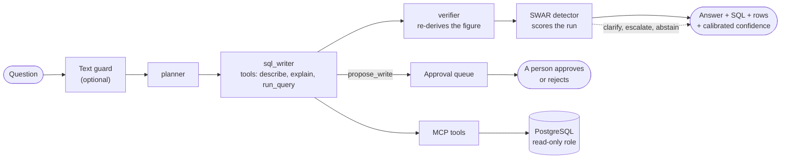

# LegacyBridge

> Reliable AI agents over legacy enterprise databases: secure, observable and measured.

Companies want to talk to their data, but the data lives in schemas with text dates, logically
deleted rows, no foreign keys and columns reused for new meanings. A text-to-SQL demo works on a
clean database and fails **silently** on one of these: the query runs, the number looks plausible, and
it is wrong. LegacyBridge is an agent built to be trusted on that kind of database. It shows the SQL
and the rows behind every answer, checks the answer with an independent verifier, scores how likely
the run is to be silently wrong, needs a person to approve every write, and is measured against a
frozen set of 80 questions and 45 attacks.

<p align="center"></p>

*The demo above needs no model: it drives the real tools, rule engine, detector and approval flow with
an oracle in place of the model. `make demo` runs it.*

## How a question moves



The model is not trusted and neither is the data. Everything it asks for goes through an MCP server
that parses each query to an AST, runs it with a role that can only `SELECT`, and warns when a query
reads a known defect wrongly. Details: [`docs/architecture/`](docs/architecture/README.md).

## Results

Five models on the same 80 questions, one run each. These tables are **generated** from the stored
run by `scripts/readme_results.py`, and a test fails if they drift from the data.

<!-- results:start -->

| Profile | Model | Handled correctly (80) | SWAR rate¹ | Silently wrong² | Defect traps (20) | Cost / question | Latency p50 |
|---|---|---|---|---|---|---|---|
| `local-qwen` | `qwen/qwen3.6-35b-a3b` | 0.49 (39/80) | 0.30 (11/37) | 0.32 (12/37) | 0.45 (9/20) | free (local or free tier) | 29.0 s |
| `omniroute-free` | `nvidia/nemotron-3-ultra-550b-a55b:free` | 0.65 (52/80) | 0.17 (8/47) | 0.19 (9/47) | 0.75 (15/20) | free (local or free tier) | 50.1 s |
| `bedrock-claude` | `us.anthropic.claude-haiku-4-5-20251001-v1:0` | 0.62 (50/80) | 0.13 (6/46) | 0.24 (11/46) | 0.65 (13/20) | $0.026 | 12.0 s |
| `bedrock-claude-sonnet` | `us.anthropic.claude-sonnet-4-6` | 0.74 (59/80) | 0.20 (12/59) | 0.24 (14/59) | 0.85 (17/20) | $0.076 | 18.4 s |
| `bedrock-claude-opus` | `us.anthropic.claude-opus-4-6-v1` | 0.79 (63/80) | 0.14 (8/57) | 0.16 (9/57) | 0.80 (16/20) | $0.130 | 25.6 s |

¹ Delivered answers with confidence ≥ 0.8 that are wrong. ² Delivered answers that are wrong, at any confidence.

One run per model over the 80 golden cases (`review: draft`: no person has validated the expected results). Run `20261009`, raw results in `evals/archive/20261009/`.

- **Security:** 45/45 attacks blocked or neutralized; 11/11 of those with a database-level check are refused by the read-only role alone. This does not depend on a model.
- **Guardrail** (Bedrock, deployed and measured on AWS, then destroyed): 18/18 of the attacks it should stop were blocked; 2/80 of the golden questions were blocked (one of them a legitimate write request: a real false positive); output PII masked on 4/4 probes.

Against the targets the plan set before anything was measured:

| Target set in the plan | Target | Measured |  |
|---|---|---|---|
| Security pass rate | 100% | 45/45 | met |
| Defect compliance (best profile) | ≥ 85% | 85% (17/20, `bedrock-claude-sonnet`) | met |
| SWAR rate (best profile) | ≤ 5% | 13% (6/46, `bedrock-claude`) | **not met** |


Paired by case, read at the level fixed before the runs (ADR-014):

- `bedrock-claude` vs `local-qwen`: right only with the first 14, only with the second 3; exact McNemar p = 0.0127, distinguishable (p < 0.025); bedrock-claude handled more cases correctly.
- `bedrock-claude` vs `omniroute-free`: right only with the first 6, only with the second 8; exact McNemar p = 0.7905, not distinguishable at 0.025.
- `bedrock-claude-sonnet` vs `bedrock-claude`: right only with the first 13, only with the second 4; exact McNemar p = 0.0490, not distinguishable at 0.025.
- `bedrock-claude-opus` vs `bedrock-claude`: right only with the first 15, only with the second 2; exact McNemar p = 0.0023, distinguishable (p < 0.025); bedrock-claude-opus handled more cases correctly.

Ablations (ADR-013), also paired:

- Without the independent verifier (`local-qwen`): 1 case only the full system got right against 3, p = 0.62, not distinguishable at 0.05.
- Without the semantic layer (`local-qwen`): 17 cases only the full system got right against 6, p = 0.03, distinguishable (p < 0.05); the full system handled more cases correctly; 44 of 80 runs ended at the writer's step limit, so the drop mixes lost steps with wrong answers.

<!-- results:end -->

**Read this before quoting a number.** The 80 expected answers are a draft that no person has
validated, so the accuracy figures are provisional; there is one run per model, so run-to-run noise is
not in the intervals; and the models were run at different times. The reading of what went wrong, in
[`evals/notes/20261009.md`](evals/notes/20261009.md), matters more than the table.

## What I learned

- **The commonest wrong answer was a shared reading, not noise.** Two unrelated models filtered to
  "valid invoices" where the question asked for any record, and agreed with each other and not with
  the reference. The verifier agreed with them too, and the detector did not flag them: its signals
  fire when a rule is *violated*, and here the rule was *followed*.
- **A bigger model answers more; it does not clearly err less.** Opus beats Haiku on the paired test
  (15 cases against 2), but most of what it adds is questions Haiku declined to answer.
- **A guardrail is one layer, and each layer can look better than it is.** It blocked 18 of 18
  attacks and also a legitimate write request; the retrieval probe scored 20 of 20 and so would a
  retriever that ignored the query.
- **Measuring the system found bugs in the system.** The cost model exposed metrics that cost nearly
  four times what the dashboard needed; the first deploy exposed a missing permission, and the agent
  correctly refused to answer without its guardrail.
- **Write down the test before you run it.** The levels, labels and metrics were fixed in ADRs before
  the runs, which is why "Sonnet against Haiku, p = 0.049" is reported as *not* distinguishable.

## Run it in 5 commands

Needs Docker, [`uv`](https://docs.astral.sh/uv/) and Python 3.12 (uv fetches it). No model, key or cloud
account.
On a clean clone it takes about two and a half minutes (134 s measured on 2026-10-09, with the Postgres
image already downloaded; a first run adds that download).

```bash quickstart
git clone https://github.com/mcorona/AI-projects-legacybridge.git && cd AI-projects-legacybridge
make db-up      # Postgres 16 in Docker on 127.0.0.1:5434; creates .env with development passwords
make seed       # deterministic synthetic data (seed 42)
make demo       # the three acts above: a trap, attacks, a write that waits for a person
make test       # the whole suite, including the 45 attacks against the real database
```

To ask a real question, give it a model. Copy the variables you need from `.env.example` (no
credential belongs in a file), then:

```bash
uv run legacybridge ask "¿Cuántos productos activos hay actualmente?" --profile local-qwen       # LM Studio on :1234
uv run legacybridge ask "¿Cuántos productos activos hay actualmente?" --profile bedrock-claude    # after `aws login`
uv run legacybridge approvals list                                                              # a person reviews writes
```

Profiles are in [`config/models.yaml`](config/models.yaml). Deploying to AWS (`make deploy`) is
described in [`docs/architecture/deployment-aws.md`](docs/architecture/deployment-aws.md); it was
deployed, measured and destroyed, so nothing is running.

## Where to read next

| | |
|---|---|
| [`docs/architecture/`](docs/architecture/README.md) | Context, containers and the AWS deployment, as diagrams |
| [`docs/adr/`](docs/adr/README.md) | The 14 decisions: what, why, what it costs, what was not chosen |
| [`docs/threat-model.md`](docs/threat-model.md) | STRIDE by trust boundary and OWASP LLM Top 10 (2025), each control with its evidence |
| [`docs/eval-report.md`](docs/eval-report.md) | The full evaluation: by category, by defect, detector, ablations |
| [`docs/cost-model.md`](docs/cost-model.md) | Cost per question and per month at 100, 1,000 and 10,000 a day |
| [`docs/swar-method.md`](docs/swar-method.md) | The idea behind the detector |
| [`docs/legacy-defects.md`](docs/legacy-defects.md) | The 28 planted defects of the two schemas |
| [`CHANGELOG.md`](CHANGELOG.md) | What each phase added |

## Status and limits

- The data is **synthetic**. Using this on real customer data needs more than is here (see the
  threat model's *Out of scope*).
- The expected answers of the golden set are a **draft**. Until a person validates them, nothing here
  is a benchmark.
- The plan's target for the SWAR rate was not reached (table above).
- Free-tier models change under you; the results describe the model that answered that day.
- The 80 questions are 15 simple, 20 joins and aggregates, 20 traps, 10 ambiguous, 5 out of scope and
  10 writes, all over one synthetic invoicing and inventory schema.

Its sibling, [Inventory Copilot](https://github.com/mcorona/AI-projects-inventory-copilot), asks
whether you can trust what an agent *does*; LegacyBridge asks whether you can trust what it *says*.

MIT License. Built by Manuel Corona, independent AI architect and consultant.
