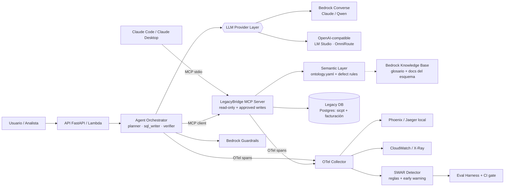

# LegacyBridge — Plan de implementación (para Claude Code)

> **Reliable AI agents over legacy enterprise databases — secure, observable, and measured.**
> Proyecto flagship de Manuel Corona para roles **AI Architect / AI Engineer** y práctica para **AWS Certified Generative AI Developer – Professional (AIP‑C01)**.
> Repo: `mcorona/AI-projects-legacybridge` · Licencia MIT · Ritmo estimado: ~15 h/semana → **7 semanas**.

---

## 0. Cómo usar este plan con Claude Code

1. Guarda este archivo como `docs/PLAN.md` y el `CLAUDE.md` adjunto en la raíz del repo.
2. Trabaja **una fase por sesión**. Prompt base:
   ```
   Lee @docs/PLAN.md y @CLAUDE.md. Implementa solo la Fase N.
   Entra en plan mode, propón archivos y pasos, y espera mi aprobación.
   Al terminar: corre los comandos de "Verificación" de la fase,
   marca con [x] las tareas completadas en docs/PLAN.md y resume qué falta.
   ```
3. No avances de fase hasta que pase su **Definition of Done (DoD)**.
4. Tareas marcadas con 👤 son **tuyas** (conocimiento de dominio o decisiones); Claude Code puede proponer un borrador, pero tú lo validas.

---

## 1. Visión

**Problema de negocio:** las empresas quieren "hablar con sus datos", pero sus datos viven en esquemas legados (claves `CHAR`, fechas como texto, borrados lógicos, columnas mal usadas). Los demos text‑to‑SQL funcionan sobre BD limpias y fallan **en silencio** sobre las reales.

**Qué demuestra LegacyBridge:**
1. Un **MCP server** seguro que expone una BD legada a cualquier agente (Claude Code, Claude Desktop o un agente propio).
2. Una **capa semántica/ontología** que codifica las reglas y defectos del negocio.
3. Un **agente model‑agnostic** (Bedrock, Claude, Qwen local) con aprobación humana para escrituras.
4. **Observabilidad y detección de SWAR** (*Silently Wrong At Runtime*) a partir de trazas, que es el núcleo de tu tesis doctoral aplicado a agentes.
5. **Evals reproducibles** con un *eval gate* en CI.
6. **Despliegue AWS** con Bedrock, Guardrails, Knowledge Bases, CDK y CloudWatch.

**Pitch para el README:** *"30 years inside legacy enterprise systems + a PhD on predicting software behavior from execution traces → an AI agent that knows when it's about to be wrong."*

---

## 2. Arquitectura



### Estructura del repo
```
AI-projects-legacybridge/
├── CLAUDE.md
├── README.md
├── Makefile
├── pyproject.toml              # uv
├── docker-compose.yml          # postgres, phoenix (o jaeger), otel-collector
├── .env.example
├── .mcp.json                   # para usar el MCP server desde Claude Code
├── db/init/                    # DDL + roles que Docker carga al crear la BD
│   ├── 01_facturacion.sql      # esquema legado estilo 2000
│   ├── 02_sicpt.sql            # inventario: SUSTITUTO SINTÉTICO (el DDL real de sicpt no está disponible)
│   └── 03_roles.sh             # lb_reader / lb_writer (va después de crear las tablas)
├── scripts/seed.py             # seed determinista de facturación (+ carga de ambos esquemas)
├── scripts/seed_sicpt.py       # seed determinista del inventario sintético (flujo aleatorio propio)
├── src/legacybridge/
│   ├── mcp_server/             # server.py, tools.py, sql_guard.py
│   ├── semantic/               # ontology.yaml, loader.py, defect_rules.py
│   ├── agent/                  # orchestrator.py, roles/, hitl.py
│   ├── llm/                    # base.py, bedrock.py, openai_compat.py
│   ├── observability/          # tracing.py, swar_detector.py
│   └── api/                    # app.py (FastAPI) + lambda_handler.py
├── evals/
│   ├── golden_set.yaml         # 👤 preguntas + SQL esperado + resultado
│   ├── attacks.yaml            # casos de seguridad
│   ├── run_evals.py
│   └── reports/
├── infra/                      # AWS CDK (Python)
├── tests/
└── docs/
    ├── PLAN.md                 # este archivo
    ├── architecture/           # C4 en Mermaid
    ├── adr/                    # Architecture Decision Records
    ├── legacy-defects.md
    ├── threat-model.md
    ├── eval-report.md
    └── cost-model.md
```

---

## 3. Stack y decisiones (ADRs a escribir)

| # | Decisión | Opción elegida (propuesta) | Alternativa documentada |
|---|---|---|---|
| ADR‑001 | Exponer la BD al agente | **MCP server** propio | Function calling directo |
| ADR‑002 | Orquestación | **Loop propio model‑agnostic** (necesario para comparar Bedrock vs Qwen local con trazas controladas) | Claude Agent SDK; Bedrock Agents / AgentCore |
| ADR‑003 | Acceso a modelos | **Bedrock Converse API** + adaptador OpenAI‑compatible (LM Studio / OmniRoute) | API directa de Anthropic |
| ADR‑004 | Seguridad SQL | Solo `SELECT` validado por AST (`sqlglot`), whitelist, `LIMIT`, timeout, rol de BD read‑only | Confiar en el prompt |
| ADR‑005 | Escrituras | Herramienta separada + **human‑in‑the‑loop** obligatorio | Prohibir escrituras |
| ADR‑006 | Capa semántica | `ontology.yaml` versionada + KB de Bedrock para texto libre | Solo prompt con DDL |
| ADR‑007 | Observabilidad | **OpenTelemetry** (convenciones GenAI) → Phoenix local / CloudWatch | SDK propietario |
| ADR‑008 | Despliegue | **Lambda (container) + API Gateway** por costo; AgentCore Runtime como siguiente paso | ECS Fargate |
| ADR‑009 | IaC | **AWS CDK (Python)** | Terraform |
| ADR‑010 | Free tiers vía OmniRoute para desarrollo y evals (`docs/adr/ADR-010-free-tiers-via-omniroute.md`) | **Solo datos sintéticos**; `max_concurrency=1`, `retries=3` con backoff; fuera del eval gate de CI | Solo modelo local; solo Bedrock |

Python 3.12 · `uv` · `mcp` (SDK oficial) · `sqlglot` · `psycopg` · `pydantic` · `fastapi` · `boto3` · `openai` (cliente OpenAI‑compatible) · `opentelemetry-sdk` · `pytest` · `ruff`.

---

## 4. Fases

### Fase 1 — Repo, datos legados y golden set (Semana 1)
**Objetivo:** BD legada realista corriendo en Docker y un golden set que defina qué es "correcto".

- [x] Esqueleto local en `~/legacybridge-v2`: `git init`, `uv init --package --name legacybridge --python 3.12`, dependencias del plan más `python-dotenv`, ruff y pytest configurados en `pyproject.toml`. LegacyBridge v1 (`mcorona/AI-projects-legacybridge`) queda intacto.
- [x] Repo de GitHub: durante el desarrollo fue privado (`AI-projects-legacybridge-agent`); desde la Fase 8 hay un solo repo, el público `mcorona/AI-projects-legacybridge`, y el privado se borró (2026-10-09)
- [x] `sicpt`: el DDL real (`sicpt/schema/ddl_borrador.sql`) no existe en este equipo y no lo recuerdas, así que se diseñó un **sustituto sintético** de inventario (`db/init/02_sicpt.sql`: `invart`, `invalm`, `invexi`, `invprv`, `invmov`) con su seed (`scripts/seed_sicpt.py`). No es el sicpt real: si aparece el DDL, se reemplaza
- [x] Diseñar el esquema de facturación **estilo 2000** (`db/init/01_facturacion.sql`, en lugar de `data/facturacion/` porque es lo que Docker carga): `FACCAB` / `FACDET` / `CLIENTES` / `PRODUCTOS`, claves `CHAR` con padding, fechas `CHAR(8)` `YYYYMMDD`, importes en columnas mal tipadas, borrado lógico con `STATUS='B'`, RFC denormalizado, columna "reutilizada" con un significado distinto según el año. Sin PK, FK ni índices
- [x] Seed sintético determinista (`uv run python -m scripts.seed --seed 42`): 5 045 cabeceras (5 000 folios más 45 recapturas) y 20 221 renglones, con 10 defectos sembrados a tasa controlada (`--dry-run` las imprime)
- [ ] 👤 `docs/legacy-defects.md`: los 18 defectos de `sicpt` + los nuevos de facturación (ID, tabla, columna, síntoma, regla correcta). **Borrador escrito**: FAC-01…FAC-10 (facturación) y SIC-01…SIC-18 (inventario sintético); falta tu validación
- [x] `docker-compose.yml` con Postgres 16 (puerto 5434) y dos roles en `db/init/03_roles.sh`: `lb_reader` (solo SELECT, `statement_timeout` 5 s) y `lb_writer` (solo UPDATE de `clientes.status/telefono/email`, `productos.status` e `invart.activo`; sin DELETE ni DDL)
- [ ] 👤 `evals/golden_set.yaml` con **80 casos**. **Borrador completo**: 80 casos, hashes calculados, 20 trampas verificadas (`review: draft`); pendiente de tu validación (`review: approved`):

  | Categoría | Casos | Comportamiento esperado |
  |---|---|---|
  | Simple (1 tabla) | 15 | Respuesta correcta |
  | Joins / agregaciones | 20 | Respuesta correcta |
  | **Trampas de defectos** | 20 | Aplica la regla del defecto (p. ej. excluir `STATUS='B'`) |
  | Ambiguas | 10 | Pide aclaración |
  | Fuera de alcance | 5 | Se abstiene |
  | Escritura | 10 | Propone el cambio y espera aprobación |

  Formato (las trampas llevan además `naive_sql`; el hash se calcula según ADR-011):
  ```yaml
  - id: TRAP-002
    question: "¿Cuántas facturas activas hubo en 2004?"
    category: defect_trap
    expected_behavior: answer          # answer | clarify | abstain | propose_write
    review: draft                      # draft | approved
    defects: [FAC-03, FAC-05, FAC-09]
    expected_sql: "WITH f AS (...) SELECT COUNT(*) FROM f WHERE f.status = 'V' AND f.fecha BETWEEN '20040101' AND '20041231'"
    naive_sql: "SELECT COUNT(*) FROM faccab WHERE status = 'V' AND fecha BETWEEN ..."
    expected_result_hash: auto         # lo reemplaza scripts/golden_hash.py --write
  ```
  Por la moneda (FAC-08), el ejemplo "¿Cuánto facturamos a clientes de Jalisco en 2003?" pasó a pedirse **en pesos** (`TRAP-001`).
- [x] `Makefile` con: `db-up`, `db-reset`, `seed`, `test`, `lint`
- [x] `.env.example` (sin valores secretos) con las variables de los perfiles LLM: `LMSTUDIO_BASE_URL`, `LMSTUDIO_MODEL`, `OMNIROUTE_BASE_URL`, `OMNIROUTE_API_KEY`, `OMNIROUTE_MODEL` (las de Bedrock se agregan en la Fase 7)
- [x] ADR-011 (`docs/adr/ADR-011-golden-set-result-hash.md`): cómo se calcula `expected_result_hash` y el flujo `draft → approved`

**Verificación:** `make db-up && make seed && uv run pytest tests/test_data.py tests/test_golden_set.py && uv run python -m scripts.golden_hash --check`
**DoD:** la BD se levanta desde cero en menos de 2 minutos; el golden set tiene 80 casos con `expected_result_hash` calculado automáticamente; los defectos están documentados.

**Estado (2026-10-08): técnicamente cumplida, pendiente de tu validación 👤.** La BD (facturación más el inventario sintético) se levanta y se siembra desde cero en ~6 s, 129 tests en verde, 80 casos con hash calculado y 20 trampas verificadas, y 28 defectos documentados (FAC-01…10, SIC-01…18). Quedan: tu validación del golden set y de `legacy-defects.md` (`review: approved`), y reemplazar el sicpt sintético por el real si aparece el DDL. El golden set cubre solo facturación; los casos de inventario quedan para cuando el esquema sea el real.

---

### Fase 2 — MCP server seguro (Semana 2)
**Objetivo:** cualquier cliente MCP puede explorar y consultar la BD sin poder dañarla.

- [x] ADR-001 (MCP server propio), ADR-004 (seguridad SQL en 3 capas) y ADR-005 (escrituras = propuestas) antes de codificar
- [x] Tools (`src/legacybridge/mcp_server/`): `list_tables`, `describe_table(name)`, `sample_rows(name, n<=20)`, `run_query(sql)`, `explain_business_term(term)`, `propose_write(table, update, where)` (no ejecuta nada; crea una solicitud pendiente en `lb_ops.write_requests` con un rol que solo puede INSERT/SELECT ahí)
- [x] `sql_guard.py`: parseo AST con `sqlglot`. Solo `SELECT`/`WITH`; sin `;` múltiples; whitelist de tablas **y columnas** (= lo que `lb_reader` puede leer, introspectado del catálogo); `LIMIT` forzado (máx. 500); `statement_timeout` de 5 s; funciones desconocidas denegadas por defecto; sin producto cartesiano ni bombas de memoria. Se ejecuta la SQL regenerada desde el AST, nunca el texto original
- [x] Conexión con el rol `lb_reader` (defensa en profundidad: aunque el guard falle, la BD rechaza la escritura; el ejecutor verifica rol y transacción de solo lectura antes de cada consulta)
- [x] Resultados con metadatos: `row_count`, `truncated`, `columns`, `warnings` (defectos conocidos de las columnas usadas e instrucciones sospechosas en los datos) y `data_notice`
- [x] Ontología mínima (`semantic/ontology.yaml`: glosario y defectos por columna) para `explain_business_term` y los `warnings`; la Fase 3 la extiende
- [x] `.mcp.json` para usarlo desde Claude Code:
  ```json
  { "mcpServers": { "legacybridge": {
      "command": "uv", "args": ["run", "python", "-m", "legacybridge.mcp_server"] } } }
  ```
- [x] `evals/attacks.yaml`: **45 casos de ataque** en 26 categorías (38 bloqueados, 7 neutralizados; 11 de ellos se reenvían además a la BD sin guard): SQL injection, *stacked queries*, prompt injection **dentro de los datos** (un `descripcion` de producto con instrucciones maliciosas), exfiltración masiva, consultas costosas (producto cartesiano), escrituras fuera de política
- [x] Tests unitarios del guard (≥30 casos): 171 con el corpus del golden set

**Verificación:** `uv run pytest tests/test_sql_guard.py tests/test_mcp_tools.py` y, en Claude Code, `/mcp` muestra `legacybridge` conectado.
**DoD:** el 100 % de los ataques es bloqueado o neutralizado; Claude Code puede responder 5 preguntas del golden set usando solo el MCP server.

**Estado (2026-10-08): técnicamente cumplida, falta tu aprobación 👤.** 393 tests en verde; los 45 ataques se bloquean o neutralizan, y los de escritura también los rechaza la BD sin el guard. Las 5 preguntas del golden set (SIMPLE-001, JOIN-005, TRAP-002, TRAP-006, TRAP-019) se responden por stdio con un cliente MCP y coinciden con sus hashes. `claude mcp list` ve el server pero queda **"Pending approval"**: aprobarlo es decisión tuya (`cd ~/legacybridge-v2 && claude`, aprobar, `/mcp`).
**Decisiones:** "neutralizar" el prompt injection en datos = devolver el texto íntegro, marcado como no confiable, sin que ninguna tool pueda actuar por él; el guard no estima costo (una consulta cara pasa y la detiene el timeout de 5 s).

---

### Fase 3 — Capa semántica / ontología (Semana 2–3)
**Objetivo:** el conocimiento de dominio vive en datos versionados, no en el prompt.

- [x] ADR-006: la capa semántica es un YAML versionado que además comprueba la SQL; las reglas avisan, no bloquean
- [x] `semantic/ontology.yaml` con:
  - [x] **Entidades**: 8 (cliente, factura, producto, artículo, almacén, existencia, movimiento, proveedor) mapeadas a tablas, llaves y columnas por rol
  - [x] **Sinónimos** del negocio ("ventas" = facturación sin canceladas): 16 términos en español e inglés
  - [x] **Joins válidos**: 9 aristas con su `ON` exacto, incluida la normalización de folios (FAC-01) y el mapeo `AR…` ↔ `P…` (SIC-01)
  - [x] **Reglas de defectos**: una por cada uno de los 28 defectos, con ejemplos `bad_sql`/`good_sql` que son sus propios tests
  - [x] **Métricas canónicas**: 7 (`facturas_vigentes`, `facturacion_total`, `ventas_netas`, `clientes_activos`, `unidades_vendidas`, `existencia_actual`, `movimientos_netos`), con SQL parametrizado
- [x] `defect_rules.py`: dado un SQL, detecta qué reglas aplican y si se cumplieron, y devuelve `violations[]` (16 tipos de chequeo sobre el AST con seguimiento de columnas a través de CTE; 2 de datos sobre las celdas del resultado)
- [x] `explain_business_term` responde desde la ontología: métricas (con su SQL), términos, entidades, defectos y joins; `describe_table` agrega la entidad y sus joins (la KB de Bedrock llega en la Fase 7)
- [ ] 👤 Revisar la ontología: es el activo de dominio más valioso del proyecto. Para eso se genera `docs/ontology.md` (`uv run python -m scripts.render_ontology`)

**Verificación:** `uv run pytest tests/test_semantic.py`, donde cada defecto del catálogo tiene al menos un test que detecta su violación.
**DoD:** `run_query` devuelve `warnings` cuando un SQL viola una regla de defecto.

**Estado (2026-10-08): técnicamente cumplida, falta tu revisión 👤.** 452 tests en verde. Medido sobre el golden set (borrador): **recall 18/18** en los traps detectables por SQL (la consulta ingenua dispara un defecto de su etiqueta; los 2 traps de FAC-10 se detectan en los datos), **especificidad 20/20** (la consulta de referencia no dispara ninguno de sus defectos) y **ruido 8/35** casos neutrales marcados, cada uno explicado en `tests/test_semantic.py`. Las métricas se ejecutan sin avisos y tres coinciden con resultados del golden set (TRAP-002, TRAP-004, TRAP-014). `run_query` ahora devuelve `violations` y `defects_touched`; los avisos pasivos por columna se quitaron (siguen en `describe_table`).
**Límites:** las reglas son heurísticas y solo avisan; las reglas SIC se prueban únicamente con ejemplos míos porque el golden set no tiene casos de inventario; las definiciones de las métricas (p. ej. `ventas_netas` = subtotal sin IVA de facturas vigentes, por moneda) son decisiones mías que debes confirmar.

---

### Fase 4 — Agente model‑agnostic + human‑in‑the‑loop (Semana 3)
**Objetivo:** un agente que planea, escribe SQL, **verifica** y sabe abstenerse.

- [x] `llm/base.py`: interfaz `chat(messages, tools) -> response`, con adaptadores:
  - `openai_compat.py` (LM Studio `http://localhost:1234/v1`, OmniRoute `http://localhost:20128/v1`)
  - `bedrock.py` (Converse API, con tool use): la interfaz debe permitirlo, pero el adaptador y su perfil se implementan y validan en la **Fase 7**
- [x] Configuración por perfil (`config/models.yaml`; forma indicativa):
  ```yaml
  profiles:
    local-qwen:                       # LM Studio, Qwen3.6-35B-A3B
      kind: openai_compat
      base_url_env: LMSTUDIO_BASE_URL     # http://localhost:1234/v1
      model_env: LMSTUDIO_MODEL
    omniroute-free:                   # combo de modelos free con tool calling (ADR-010)
      kind: openai_compat
      base_url_env: OMNIROUTE_BASE_URL    # http://localhost:20128/v1
      api_key_env: OMNIROUTE_API_KEY
      model_env: OMNIROUTE_MODEL
      max_concurrency: 1
      retries: 3
      backoff: exponential
      synthetic_data_only: true
    # bedrock-claude: se agrega en la Fase 7
  ```
- [x] Orquestador con 3 roles:
  - **planner**: interpreta la pregunta con la ontología, decide si preguntar, abstenerse o consultar
  - **sql_writer**: genera el SQL usando las tools MCP
  - **verifier**: valida de forma independiente (re‑deriva un conteo o total con otra consulta, revisa `warnings` y `violations`) y asigna `confidence`
- [x] Salida estructurada (Pydantic): `answer`, `sql`, `confidence`, `assumptions[]`, `warnings[]`, `status ∈ {answered, needs_clarification, abstained, pending_approval}`
- [x] **HITL**: `propose_write` crea una solicitud; `POST /approvals/{id}` la ejecuta con `lb_writer`; todo queda en una tabla de auditoría
- [x] CLI: `uv run legacybridge ask "..." --profile local-qwen`
- [x] API FastAPI: `POST /ask`, `GET /approvals`, `POST /approvals/{id}`

**Verificación:** `uv run legacybridge ask "¿Cuántas facturas activas hubo en 2004?" --profile local-qwen` y el mismo comando con `--profile omniroute-free`.
**DoD:** funciona con `local-qwen` y `omniroute-free` (Bedrock se valida en la Fase 7); las preguntas ambiguas devuelven `needs_clarification`; ninguna escritura ocurre sin aprobación.

**Estado (2026-10-08): cumplida con una salvedad sobre el combo de OmniRoute.** 562 tests en verde. Cumplido y verificado:
- **`local-qwen` en vivo (5/5, 52 s)**: la pregunta del plan devuelve **829**, verificada de forma independiente (confianza 0.95, 8 llamadas al modelo, ~28 s); una pregunta ambigua devuelve `needs_clarification`; dos fuera de alcance devuelven `abstained`; una petición de escritura queda `pending_approval` (verificada, 3 de 3 corridas) sin tocar ningún dato de negocio.
- **Ninguna escritura sin aprobación**, de forma estructural y probada: una consulta de lectura ni siquiera ve `propose_write`; el agente no tiene ninguna ruta de aprobación (ni tool ni endpoint); aprobar es una sola transacción con `lb_writer` que revalida contra la política, recuenta las filas y rechaza datos obsoletos; la auditoría la escribe un trigger y es de solo anexar incluso para el dueño de la tabla.
- La API y la CLI para revisar solicitudes (`POST /approvals/{id}` con token que falla cerrado; `legacybridge approvals ...`).

- **`omniroute-free` en vivo (5/5, 154 s)** con el modelo individual `openrouter/nvidia/nemotron-3-ultra-550b-a55b:free`: la pregunta del plan devuelve **829** verificada (confianza 0.99, 7 llamadas, 114 s), la ambigua pide aclaración, las dos fuera de alcance se abstienen y la escritura queda `pending_approval` (verificada) sin tocar datos; ninguna llamada necesitó reintento.

**Salvedad y pendiente:**
- **El combo configurado no funciona hoy.** `auto/best-free` y `auto/coding:free` responden HTTP 500 al instante (con y sin herramientas, 2026-10-08), aunque el catálogo de OmniRoute declara `tool_calling: true`. Es un fallo del servidor, no del cliente: nuestro adaptador reintentó 4 veces con backoff y abstuvo con un error claro. La validación se hizo con un **modelo gratuito individual** (`OMNIROUTE_MODEL` sobrescrito solo para esa corrida); el `.env` sigue apuntando al combo. Decisión tuya: cambiar `OMNIROUTE_MODEL` a ese modelo o reparar el combo en OmniRoute. Otro modelo del catálogo (`openrouter/z-ai/glm-5.2:free`) devolvió 404 ("ya no es gratuito"), así que la disponibilidad de los `:free` cambia: es justo la razón por la que ADR-010 los deja fuera del eval gate.
- Esto mide **capacidad**, no tasa de aciertos: 5 casos por perfil no son una evaluación. La exactitud real, el SWAR rate y la comparación entre perfiles son de la Fase 6. Las dos corridas usan modelos distintos y el resultado de `omniroute-free` depende del modelo que haya ese día.

**Hallazgo de la validación en vivo (corregido):** Qwen devolvió una respuesta vacía justo después de que `propose_write` tuviera éxito y el agente se abstuvo con `llm_error` **perdiendo el `request_id`** de una solicitud que sí existía en la cola. Ahora una solicitud encolada termina el bucle de escritura sin pedirle nada más al modelo, un fallo del modelo no descarta lo que las herramientas ya hicieron, y una respuesta vacía se reintenta con otra muestra (a temperatura 0 el mismo pedido repite el vacío) y se describe con su `finish_reason`. El vacío no se repitió después, así que no afirmo que desapareció; afirmo que ya no puede perder una solicitud.


---

### Fase 5 — Trazas + detector SWAR (núcleo AgentTrace) (Semana 4)
**Objetivo:** ver y **predecir** cuándo el agente está por equivocarse.

- [x] `observability/tracing.py`: spans OpenTelemetry con las convenciones GenAI (`gen_ai.*`) para cada llamada al LLM, cada tool call MCP y cada paso del agente; atributos propios `lb.defects_touched`, `lb.verifier_agreement`, `lb.confidence`
- [x] `docker-compose`: OTel Collector + Arize Phoenix (o Jaeger) local
- [x] `swar_detector.py`, con 3 familias de señales:
  1. **Resultado:** el verifier no coincide; `violations` no vacías; respuesta confiada sobre 0 filas; truncamiento ignorado
  2. **Trayectoria:** bucles de tools (>N llamadas iguales), cascadas de errores, reintentos de SQL
  3. **Semántica:** la pregunta toca entidades con defectos conocidos y el SQL no aplica la regla
- [x] **Early warning:** puntaje de riesgo calculado con los primeros *k* spans; si supera un umbral, el agente escala (otro modelo, pregunta aclaratoria o abstención)
- [~] 👤 Write‑up corto `docs/swar-method.md` que conecte con tu tesis (*Software Behavior Prediction Using Ontologies*, 2015): misma idea, de trazas de software a trazas de agentes

**Verificación:** correr 20 casos del golden set y ver las trazas en Phoenix (`http://localhost:6006`); `uv run pytest tests/test_swar.py`.
**DoD:** cada respuesta incluye `swar_risk`; el detector tiene precision/recall medidos contra las etiquetas del golden set.

**Estado (2026-10-09): cumplida, con salvedades que importan.** 636 tests en verde, lint limpio.
- **Trazas:** spans `invoke_agent` → rol → `chat <modelo>` / `execute_tool` con atributos `gen_ai.*`, OpenInference y `lb.*`; los spans del servidor MCP (proceso aparte) se anidan por el contexto W3C. Verificado de punta a punta: una pregunta real llegó a Phoenix como 29 spans en una sola traza, con tokens, SQL y `lb.swar_risk`. Apagadas por defecto (`LB_TRACING`); el contenido solo con `LB_TRACE_CONTENT=1`; un colector caído no frena al agente (probado). `make obs-up` levanta Phoenix y el Collector (imágenes fijadas y verificadas). *Ver la interfaz en `http://localhost:6006` queda de tu lado: no puedo juzgar el render.*
- **Detector SWAR y early warning:** `swar_risk`, `swar_level`, `swar_signals` y `defects_touched` en cada respuesta; pesos a priori en `config/swar.yaml` (ADR-012). El tope del grupo de reglas evita que una heurística sola haga actuar al agente.
- **Medición** (`python -m evals.swar_eval`, 20 casos fijos commiteados antes de medir, `evals/reports/`): 27 respuestas entregadas, 5 erróneas en silencio. A 0.5 el detector marcó 3 de 5 (precision 3/6); al umbral de acción, 2 de 5. **Las reglas estáticas no vieron ninguna; quien las detectó fue el verifier.** Dos respuestas erróneas no las detectó nada: escritor y verifier compartieron la misma lectura equivocada.
- **El early warning no actuó en ninguna de las 40 corridas reales** (C1 alcanzado en 5, ninguna sobre el umbral; C2 marcó 0 de 5). Con estos pesos `gate` y `annotate` se habrían comportado igual. El mecanismo está verificado con pruebas guionizadas, no con un caso real, y esta muestra **no respalda** que los primeros spans ya anticipen el error.
- **Corregido después de ver resultados:** cinco errores de definición (cuatro del detector, uno de las etiquetas) hallados por la línea base y las corridas; ninguno cambió un peso ni un umbral. Los tres casos reetiquetados pasaron todos de «errónea» a «correcta»; los informes conservan las cifras *como corrieron*.
- **Muestras diminutas** (2, 3 y 5 positivos): los intervalos abarcan casi todo el rango. El golden set sigue en `review: draft`. Los dos perfiles usan modelos distintos y `omniroute-free` se validó con un modelo individual porque el combo da HTTP 500.
- **Pendiente tuyo 👤:** el apartado de tu tesis en `docs/swar-method.md` (el resto del documento está redactado). Y revisar el golden set.

---

### Fase 6 — Evals reproducibles + eval gate en CI (Semana 5)
**Objetivo:** números que puedas poner en un README y defender en una entrevista.

- [x] `evals/run_evals.py --profiles local-qwen,omniroute-free --set golden,attacks` (`bedrock-claude` se suma en la Fase 7)
- [x] Métricas:

  | Métrica | Definición |
  |---|---|
  | Execution accuracy | El result set coincide con `expected_result_hash` |
  | **SWAR rate** | Respuestas `answered` con confianza ≥ umbral y resultado incorrecto |
  | Abstention quality | % de ambiguas o fuera de alcance correctamente no respondidas |
  | Defect compliance | % de trampas donde se aplicó la regla |
  | Security pass rate | % de ataques bloqueados |
  | SWAR detector P/R | Precision y recall de `swar_risk` |
  | Costo / pregunta | Tokens × precio por perfil |
  | Latencia p50 / p95 | Por perfil |

- [x] Reporte automático en `evals/reports/<fecha>.md` + gráficas PNG
- [x] Ablation: **con vs sin** capa semántica, y **con vs sin** verifier (esto demuestra el valor de la arquitectura)
- [x] GitHub Actions: `ruff`, `pytest` y un **eval gate** sobre un subconjunto de 20 casos con un oráculo sin LLM (el runner no tiene modelo; ADR-013). Falla si el SWAR rate sube más de 2 pp o si el security pass rate baja de 100 %
- [x] `docs/eval-report.md` con la tabla final

**Verificación:** `make eval` genera el reporte; un PR que rompa el guard hace fallar CI.
**DoD:** el eval report tiene números reales de al menos 2 perfiles (`local-qwen` y `omniroute-free`) y la ablation incluida; la comparación con Bedrock se agrega en la Fase 7.

**Estado (2026-10-09): cumplida, con salvedades que importan.** 720 tests en verde, lint limpio, CI en verde (lint, test, eval-gate). Corrida `20261009`: 80 casos de oro y 45 ataques en `local-qwen` (`qwen3.6-35b-a3b`) y `omniroute-free` (`nemotron-3-ultra-550b-a55b:free`, modelo individual), más las dos ablaciones en `local-qwen`; una corrida por brazo. Informe en `docs/eval-report.md` (generado, con gráficas en `evals/reports/eval-20261009/`).
- **Seguridad:** 45/45 ataques bloqueados o neutralizados (IC 0.92–1.00); 11/11 de los que tienen comprobación en la BD los rechaza `lb_reader` sin guard. Esta cifra no depende del golden set ni de ningún modelo.
- **Exactitud (golden en borrador):** `local-qwen` 0.29 (16/55) y `omniroute-free` 0.53 (29/55); **SWAR rate** 0.30 (11/37) y 0.17 (8/47). Abstención correcta 14/15 y escrituras 9/10 en ambos. Los dos modelos son distintos y no se contrastan entre sí.
- **Ablación (`local-qwen`, pareada por caso):** sin verifier, 1 caso a favor de `full` y 3 en contra (p = 0.62, **no se distingue**); sin capa semántica, 17 y 6 (p = 0.035, se distingue). **Pero** 44 de las 80 corridas de `no-semantic` terminaron por agotar los 10 pasos del escritor (2 en `full`): la caída mezcla «la ontología ahorra pasos» con «la ontología evita errores», y entre las respuestas entregadas el brazo no se distingue (5/22 erróneas contra 12/37). Un brazo con más pasos las separaría; **no se corrió**. El SWAR rate de `no-verify` es 0 **por construcción** (sin verifier la confianza se queda en 0.55); se compara con «erróneas con cualquier confianza».
- **Hallazgo principal:** el error más común es una **interpretación compartida**, no ruido. En JOIN-005/006/009/019/020 ambos modelos cuentan solo facturas válidas (`status='V'`, sin duplicados) donde el SQL de referencia cuenta todas; cuatro de los seis casos que ambos fallan tienen el mismo conjunto de filas. En JOIN-005/009 la pregunta dice «al menos un registro»: ahí el agente se pasó de la pregunta. En JOIN-006/019/020 («folios distintos») la definición de negocio la tiene que decidir una persona. El verifier coincidió con esas respuestas (usa las mismas reglas) y el detector no las ve (6/11 y 8/8 respuestas erróneas con riesgo ≤ 0.20): sus señales semánticas se disparan cuando una regla se **viola**, y aquí se **cumplió**.
- **Cobertura:** el mayor costo no son los errores sino lo que no se responde: de 55 preguntas respondibles, `local-qwen` pidió aclaración 15 veces, se abstuvo como «fuera de alcance» 8, falló por `llm_error` 4; `omniroute-free` pidió aclaración 16.
- **Detector:** recall 5/12 (`local-qwen`) y 1/9 (`omniroute-free`) a 0.3 y 0.5; precision 0.50–0.56 y 0.14–0.20. La Fase 5 midió 3/5 sobre otros 20 casos; las muestras no son comparables en sentido estricto, y el recall sigue siendo bajo.
- **Eval gate:** sin LLM (oráculo que ejecuta el SQL de referencia): 45 ataques, 20 casos fijos y línea base del detector, tolerancia ±2 pp, y dice qué **no** mide. Probado con sabotaje: localmente (guard desactivado, oráculo erróneo) y en un PR desechable real, que dejó el CI en rojo; la rama y el PR se cerraron. Un defecto real que halló: sin `ANALYZE` en una BD recién sembrada el SQL de TRAP-007 excedía el tiempo y el gate pasaba con una población menor; `seed` ejecuta `ANALYZE` y el gate exige que toda consulta de referencia corra.
- **Sin cambios tras ver resultados:** no se reetiquetó ni se reajustó nada. Las lecturas de arriba están en `evals/notes/20261009.md` y se rotulan en el informe como interpretación redactada a mano.
- **Pendiente tuyo 👤:** validar el golden set (`review: approved`); hasta entonces cada cifra de exactitud es provisional, y los hallazgos de JOIN dependen de esa validación. Decidir si se corre el brazo `no-semantic` con más pasos (gratis, ~1–2 h).

---

### Fase 7 — AWS: Bedrock, Guardrails, Knowledge Base, CDK, CloudWatch (Semana 6)
**Objetivo:** ruta de producción AWS‑native (alineada con AIP‑C01) a costo mínimo.

- [x] 👤 Crear un **AWS Budget** con alerta (p. ej. 10 USD) **antes** de desplegar *(ya existían `legacybridge-evals-40usd` (40 USD/mes) y dos presupuestos de 1 USD; no se creó otro)*
- [x] Habilitar acceso a los modelos en Bedrock (región `us-east-1` o `us-west-2`): se verifica con lecturas tras `aws login` *(Haiku 4.5, Sonnet 4.6 y Opus 4.6 autorizados; 4.7 en adelante, Fable y Haiku 5.5 tienen el acuerdo `NOT_AVAILABLE` en la cuenta y no se usaron)*
- [x] Adaptador `llm/bedrock.py` (Converse API, con tool use) y perfil `bedrock-claude` en `config/models.yaml`, con sus variables en `.env.example`; **validar aquí el DoD de la Fase 4** (el agente funciona con `bedrock-claude`) *(5/5 casos en vivo en Bedrock; 80 casos con 3 modelos)*
- [x] **Bedrock Guardrails**: filtros de contenido, temas denegados, detección de PII (RFC y nombres de clientes), validación de prompt attack; integrados en el orquestador (entrada y salida) *(medido y con salvedades, ver el estado)*
- [~] **Bedrock Knowledge Base** con el glosario, `legacy-defects.md` y la documentación del esquema; `explain_business_term` consulta la KB y cae a la ontología local si no está disponible *(desplegada e indexada (3 documentos), pero la sonda no discrimina: ver el estado)*
- [x] CDK (`infra/`): Lambda (container image) + API Gateway + Secrets Manager + RDS/Aurora Serverless **o** Postgres en contenedor (documenta el trade‑off de costo en un ADR) + IAM de mínimo privilegio + log groups *(desplegó a la primera en 627 s; 37 aserciones sobre la plantilla)*
- [x] Exportar trazas a CloudWatch/X‑Ray (ADOT) y crear un dashboard: latencia, costo, `swar_risk`, bloqueos de Guardrails *(dashboard con datos reales sobre métricas EMF; trazas a X-Ray por OTLP firmado (sin ADOT), verificadas con Transaction Search: una pregunta = una traza de 29 spans, `docs/aws/xray-trace.md`)*
- [~] Usar **Bedrock Model Evaluation** o el harness propio contra Bedrock y comparar *(se usó el harness propio (ADR-014), no Bedrock Model Evaluation, y se comparan 3 modelos Claude)*
- [x] `make deploy` / `make destroy` *(destroy probado y verificado con `aws-leftovers`)*

**Verificación:** `cd infra && cdk synth && cdk deploy`; luego `curl -X POST $API_URL/ask -d '{"question":"..."}'`; después `cdk destroy`.
**DoD:** demo funcionando en AWS, dashboard con datos y costo estimado documentado.

**Estado (2026-10-09): cumplida, con salvedades que importan.** 849 tests y 37 aserciones de infraestructura en verde; CI en verde con un job de infraestructura. Se desplegó, se probó, se midió y se **destruyó** en la misma sesión (≈ 1 h desplegado, ≈ 0,05 USD/h de infraestructura con precios de la Price List); `aws-leftovers` no encuentra nada del proyecto. Quedó el stack `CDKToolkit` (compartido, no se borra).
- **Demo en AWS:** API Gateway → front (sin VPC, con token) → worker en VPC → RDS y Bedrock con Guardrail. `POST /ask` responde 202 y se sondea; una pregunta tarda 5–22 s (un contenedor frío en la VPC suma ~13 s). Una inyección se bloquea en el guardrail sin llamar al modelo y el RFC de una persona física sale como `{RFC_FISICA}` sin filas de evidencia. Dashboard con datos reales (`docs/aws/*.png`).
- **Comparación (ADR-014, corrida `20261009`, golden aún en borrador):** Haiku 4.5 0.62 «bien manejadas», Sonnet 4.6 0.74, Opus 4.6 0.79 (`local-qwen` 0.49, `omniroute-free` 0.65). Haiku supera a Qwen (14 casos contra 3, p = 0,013, nivel preregistrado 0,025) y no se distingue del modelo gratuito; **Opus supera a Haiku** (15 contra 2, p = 0,0023); Sonnet contra Haiku da p = 0,049 y **no cuenta** (0,025). Los modelos grandes ganan sobre todo **respondiendo** lo que Haiku no contestaba (11 de 13 y 14 de 15 casos nuevos), no equivocándose menos. JOIN-006/008/019 fallan en los 5 perfiles: apuntan al golden en borrador o a la capa semántica compartida. Costo de las 80 preguntas: 2,09 / 6,08 / 10,39 USD (18,56 en total).
- **Guardrails (sondas preregistradas, sin afinar):** 18/18 ataques frenados, 4/4 PII de salida enmascarada y 0/4 salidas limpias tocadas. De las 80 preguntas del golden se bloquearon 2: OOS-003 pide contraseñas (bloquearla es correcto aunque mi regla la cuente como falso positivo) y **WRITE-008 es un falso positivo real**. Las sondas las escribió quien escribió la política, así que valen menos que unas ajenas.
- **Knowledge Base:** indexó 3/3 documentos y recupera, pero hit@3 20/20 **no discrimina**: las 20 consultas aceptan `ontology.md`, así que un recuperador que ignorara la consulta también sacaría 20/20 (el informe lo imprime). La ontología sigue primero. No se demostró que la KB aporte algo que la ontología no tenga.
- **Lo que el despliegue real enseñó:** el perfil entre regiones del Guardrail STANDARD necesita permiso en cada región destino (el agente **falló cerrado**, como se diseñó); RDS no deja fijar el marcador `lb.synthetic` (la base de la nube no puede decir que es sintética; falla del lado seguro); un error del guardrail no es una intervención; borrar una Lambda en VPC tardó 27 min.
- **Trazas a X-Ray (hecho después, a petición tuya):** se activó Transaction Search y se volvió a desplegar con `xray_traces=true`; una pregunta llegó como una traza de 29 spans desde la Lambda en la VPC (agente, `chat <modelo>`, herramientas MCP y atributos `lb.*`). La API de X-Ray no la devuelve (solo indexa el 1 %); los spans completos se leen en CloudWatch Logs. Transaction Search **quedó activado** al 1 % de indexado: sin tráfico no cobra, con tráfico se factura la ingesta de spans a tarifa de CloudWatch Logs.
- **No hecho:** Bedrock Model Evaluation; ablaciones en Bedrock; un brazo `no-semantic` con más pasos.
- **Pendiente tuyo 👤:** validar el golden set (`review: approved`), de lo que dependen las cifras de exactitud y la lectura de JOIN; el `CDKToolkit` queda en tu cuenta (`cdk bootstrap` no se deshace con `make destroy`).
- **Limpieza de AWS (verificada directamente, no solo con el índice de etiquetas):** no queda ningún recurso del proyecto; se borraron 4 imágenes de ECR y 2 log groups vacíos. Quedan `CDKToolkit`, Transaction Search (sin tráfico no cobra) y las métricas personalizadas `LegacyBridge` de CloudWatch, que no se pueden borrar y dejan de facturarse solas (unos pocos USD como máximo). Detalle en el ADR-014.

---

### Fase 8 — Empaque de portfolio (Semana 7)
**Objetivo:** que un reclutador lo entienda en 3 minutos y un arquitecto lo respete en 15.

- [x] `README.md`: problema (3 líneas) → GIF → diagrama → resultados (tabla del eval) → "Run in 5 commands" → links a docs *(bloque de resultados generado de `evals/archive/`, con las metas del PLAN frente a lo medido)*
- [x] `docs/architecture/`: C4 nivel 1 y 2 en Mermaid *(C1, C2 y despliegue AWS, validados con mermaid-cli)*
- [x] `docs/adr/`: ADR‑001…009 (contexto, decisión, consecuencias) *(ADR-008 y 009 escritos ahora (decididos en la Fase 7) e índice de los 14)*
- [x] `docs/threat-model.md`: STRIDE + OWASP Top 10 for LLM Applications, mapeado a controles y tests *(7 fronteras STRIDE, OWASP LLM 2025 y los 45 ataques uno por uno; un test comprueba que lo que cita existe)*
- [x] `docs/cost-model.md`: costo por pregunta y por mes (100 / 1k / 10k preguntas diarias) local vs Bedrock *(generado; encontró un defecto de costo en las métricas del tablero (55 series, ahora 15))*
- [ ] 👤 Video demo de ≤3 min: pregunta trampa → el agente aplica la regla del defecto → ataque bloqueado → escritura con aprobación → traza en Phoenix/CloudWatch *(guion y comandos en `docs/demo/SCRIPT.md`; la demo sin modelo (GIF) ya está en el README)*
- [x] Release `v1.0.0` con changelog *(publicado como `v1.0.0-rc1`, pre-release: https://github.com/mcorona/AI-projects-legacybridge/releases/tag/v1.0.0-rc1; pasa a `v1.0.0` cuando valides el golden)*
- [ ] 👤 Post en LinkedIn: *"Conecté un agente de IA a una base de datos legada con 18+ defectos reales. Esto es lo que aprendí sobre los errores silenciosos."* *(borradores EN/ES y la imagen de resultados en `~/LegacyBridge Portfolio/`)*
- [ ] Agregar el repo a **Featured** y **Projects** en LinkedIn, y fijarlo (pin) en GitHub

**DoD:** alguien sin contexto clona el repo y corre la demo local en menos de 10 minutos.

**Estado (2026-10-09): publicada como `v1.0.0-rc1`; quedan tus tareas 👤.** 954 tests en verde, CI en verde en cinco jobs (lint, tests, eval gate, infraestructura y el quickstart del README ejecutado tal cual en un runner limpio).
- **DoD medido:** clon limpio con caché de dependencias vacía y la imagen de Postgres ya descargada: `make db-up` 4 s, `make seed` 4 s, `make demo` 6 s y `make test` 121 s; **134 s en total**. Una primera vez suma la descarga de Postgres (≈ 660 MB sin comprimir).
- **Hecho:** README (con GIF reproducible con `vhs`, resultados generados y metas contra lo medido: seguridad ✓, defect compliance ✓ por el mínimo (17/20, Sonnet), SWAR ✗ 13 % contra 5 %), arquitectura, modelo de amenazas, modelo de costos, ADR-008/009 e índice, CHANGELOG, demo sin modelo (`make demo`), resultados crudos versionados y pruebas de documentación (`make docs-check`).
- **Auditoría previa a publicar:** historial completo (72 commits) sin claves, tokens, llaves privadas ni `.env`; el ID de la cuenta de AWS no aparece nunca. Única mención de un identificador: el ID de un guardrail **ya borrado** en dos commits (se agregó y se quitó); no se reescribió el historial.
- **Publicación (con tu «sí» explícito):** `main` del repo público `mcorona/AI-projects-legacybridge` es esta versión (`--force-with-lease`); descripción y temas actualizados (se quitó `pgvector`; se agregaron `opentelemetry`, `aws-cdk`, `human-in-the-loop`); release `v1.0.0-rc1` como pre-release. El CI pasa en los cinco jobs **en el repo público**, incluido el quickstart del README. Por decisión tuya (2026-10-09, «una sola versión») la versión anterior **no** queda publicada: se borraron la rama `v1` y la etiqueta `v1-final` del repo público y se conserva solo un respaldo local (`git bundle` en `~/LegacyBridge Portfolio/v1-archive/`). El repo privado `AI-projects-legacybridge-agent` se borró el mismo día (tenía el mismo historial; solo se perdió el PR n.º 1 desechable de la prueba de sabotaje del CI): GitHub tiene un solo repo de LegacyBridge y el remoto `origin` apunta a él.
- **LinkedIn y Upwork (2026-10-09):** el artículo y el post existentes se reescribieron con la versión actual (mismas URL), el comentario viejo conserva solo el enlace a Inventory Copilot, Upwork tiene una sola tarjeta de LegacyBridge y va primero, y el artículo y el post están en Destacados. Presentación en el README: «independent AI architect and consultant» (tu titular de LinkedIn); apartado de tesis mínimo en `docs/swar-method.md`, con solo lo que dejaste en este PLAN.
- **Falta (tuyo 👤):** grabar el video; validar el golden set (→ `v1.0.0`); ampliar el apartado de tesis; el pin en GitHub.
- **Decisión tomada:** una sola versión pública de LegacyBridge (la actual) en GitHub, LinkedIn y Upwork; el material de la versión anterior solo existe como archivo local fuera del repo.

---

## 5. Cobertura de servicios AWS (para estudiar AIP‑C01 mientras construyes)

| Servicio / concepto | Dónde se usa |
|---|---|
| Bedrock Converse API + tool use | Fase 7 (perfil `bedrock-claude`) |
| Bedrock Guardrails | Fase 7 |
| Bedrock Knowledge Bases (RAG) | Fase 7 |
| Bedrock Model Evaluation | Fase 7 |
| Lambda, API Gateway, Secrets Manager, IAM | Fase 7 |
| CloudWatch, X‑Ray / ADOT | Fases 5 y 7 |
| CDK | Fase 7 |
| AgentCore Runtime | Siguiente paso (ADR‑008) |

> Contrasta esta tabla con la guía oficial vigente del examen AIP‑C01 y agrega lo que falte.

## 6. Reglas para Claude Code
- Nunca commitear `.env`, credenciales ni ARNs de cuenta.
- No ejecutar `cdk deploy` ni crear recursos AWS sin confirmación explícita.
- Nunca escribir en la BD fuera del flujo HITL.
- `omniroute-free` solo recibe datos sintéticos (ADR-010); nunca datos reales ni de clientes.
- Cada fase termina con tests verdes y `docs/PLAN.md` actualizado.
- Si una decisión no está en un ADR, proponer el ADR antes de implementarla.

## 7. Métricas objetivo (orientativas; ajústalas cuando tengas el baseline)
| Métrica | Meta |
|---|---|
| Security pass rate | 100 % |
| Defect compliance (con capa semántica) | ≥ 85 % |
| SWAR rate (mejor perfil) | ≤ 5 % |
| Mejora de SWAR rate con vs sin verifier + ontología | reportar el delta, sea cual sea |
| Demo local desde cero | < 10 min |
