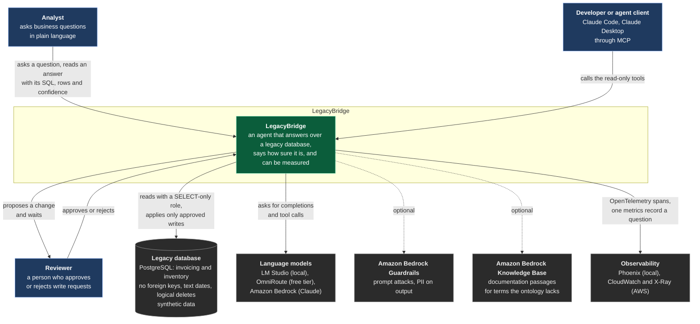

# C1 — System context

Who uses LegacyBridge and what it depends on. Everything inside the dashed box is this repository.

## Trust boundaries

- The **model** is not trusted: it never sees credentials, cannot approve a write, and everything it
  asks for goes through the tools (the SQL guard, the roles, the rule engine).
- The **data** is not trusted either: free-text columns hold text written to look like instructions
  (defect FAC-10), and results are returned as data, flagged, never as instructions.
- A **person** is the only thing that can change business data (ADR-005).

See `docs/threat-model.md` for the threats and the controls, and `c2-containers.md` for the inside.
