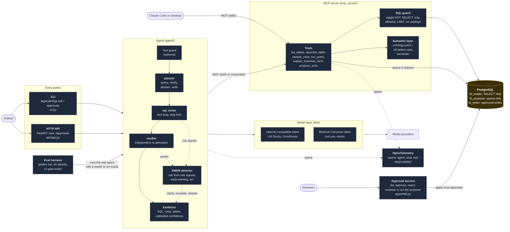

# C2 — Containers

What runs inside LegacyBridge, and how a question moves through it. Names match the code under
`src/legacybridge/`.

## One question, in order

1. The entry point passes the question to the agent. If a guardrail is configured, the question is
   checked first; a block ends the run before any model is called.
2. The **planner** decides: answer from data, ask for clarification, abstain, or propose a write.
3. The **sql_writer** loops over the tools (`describe_table`, `explain_business_term`, `run_query`)
   until it submits an answer that points at a query that really ran. The facts of the answer
   (the SQL, the rows, the tables) come from the tool calls, never from what the model says.
4. The **verifier** re-derives the figure with its own queries and says whether it agrees.
5. The **SWAR detector** scores the run from raw signals (result, trajectory, semantics), never from
   the agent's confidence, and may ask for clarification, escalate to a second profile, or abstain.
6. The answer leaves with its **evidence**: the SQL that ran, the rows, the tables, the defects
   touched and a calibrated confidence.

## Where the safety lives

| Layer | Where | What it stops |
|---|---|---|
| SQL guard | `mcp_server/sql_guard.py` | anything but one SELECT on allowed tables and columns |
| Database roles | `db/init/03_roles.sh` | writes, even if the guard failed (11 of 11 attacks with a database check) |
| Rule engine | `semantic/defect_rules.py` | queries that read a defect wrongly: it warns, with the fix |
| Human approval | `agent/hitl.py` | any change to business data |
| Text guardrail | `llm/bedrock_guardrails.py` | prompt attacks in, personal data out (optional) |

The decisions behind each box are in `docs/adr/`.
