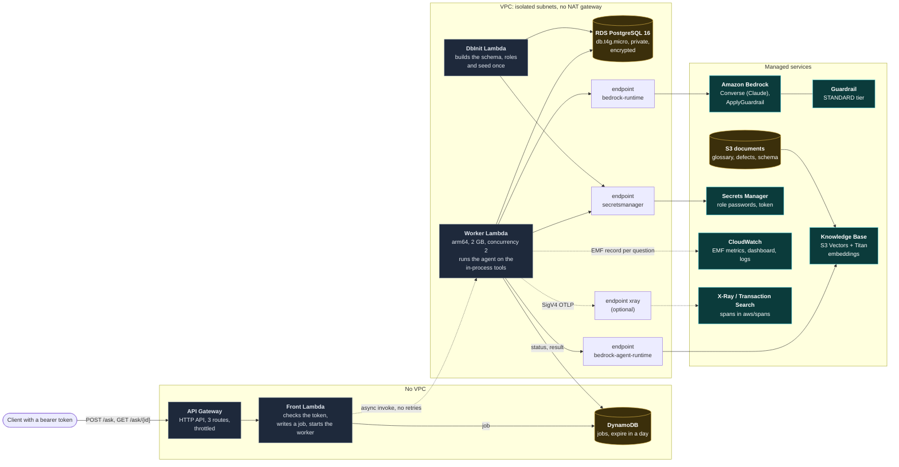

# Deployment on AWS

The shape of the stack that `infra/` deploys (ADR-014). It was deployed, tested and destroyed;
nothing here is running. Costs are in `docs/cost-model.md`.

## Why it is shaped this way

- **Two functions.** API Gateway ends a request at 30 seconds and an agent run can take longer, so
  `POST /ask` answers `202` with a job id and the client polls. The function that takes the request
  has no VPC, no database and no model access: whoever breaks into it can read jobs and start
  questions, nothing else. Only the worker sees the database and the model.
- **No NAT gateway.** The worker reaches AWS through interface endpoints, which cost less than a
  NAT gateway and open no route to the internet. The price is a timeout, silent, if one endpoint is
  missing.
- **Fail closed.** The front refuses to start without its token; a guardrail that cannot run ends
  the question instead of letting it through; approvals are off in the cloud, so a write request is
  only queued.
- **Everything is removed by `make destroy`**, and `make aws-leftovers` checks it directly, not
  through the tag index (which lags).

What the first deploy taught is recorded in ADR-014: the guardrail's cross-region profile needs its
own permissions, RDS refuses the synthetic marker, and deleting a Lambda in a VPC takes about 25
minutes.
